<!-- Сгенерировано tools/knowledge/render_docs.py. Не править руками: правьте модель и перегенерируйте. -->

# События

Транзакционный outbox (`events.outbox`) → Redis Streams → обработчики сервисов.

```mermaid
flowchart LR
    service_applications[applications]
    service_billing[billing]
    service_chat[chat]
    service_notifications[notifications]
    service_scheduling[scheduling]
    application_archived([application.archived])
    service_applications --> application_archived
    application_archived --> service_chat
    application_archived --> service_scheduling
    application_closed_duplicate([application.closed_duplicate])
    service_applications --> application_closed_duplicate
    application_closed_duplicate --> service_billing
    application_closed_duplicate --> service_chat
    application_closed_duplicate --> service_scheduling
    application_ready_for_booking([application.ready_for_booking])
    service_applications --> application_ready_for_booking
    application_ready_for_booking --> service_scheduling
    application_review_passed([application.review_passed])
    service_applications --> application_review_passed
    application_review_passed --> service_applications
    application_stage_changed([application.stage_changed])
    service_applications --> application_stage_changed
    application_stage_changed --> service_chat
    application_unarchived([application.unarchived])
    service_applications --> application_unarchived
    application_unarchived --> service_billing
    application_unarchived --> service_chat
    application_venue_changed([application.venue_changed])
    service_applications --> application_venue_changed
    application_venue_changed --> service_billing
    application_venue_changed --> service_chat
    application_venue_changed --> service_scheduling
    booking_cancelled([booking.cancelled])
    service_scheduling --> booking_cancelled
    booking_cancelled --> service_chat
    booking_cancelled --> service_notifications
    booking_created([booking.created])
    service_scheduling --> booking_created
    booking_created --> service_chat
    booking_created --> service_notifications
    books_issued([books.issued])
    service_scheduling --> books_issued
    books_issued --> service_applications
    client_updated([client.updated])
    service_applications --> client_updated
    client_updated --> service_applications
    halls_booking_cancelled([halls.booking_cancelled])
    halls_booking_confirmed([halls.booking_confirmed])
    halls_booking_created([halls.booking_created])
    halls_booking_held([halls.booking_held])
    halls_booking_prepaid([halls.booking_prepaid])
    halls_invoice_issued([halls.invoice_issued])
    halls_payment_received([halls.payment_received])
    halls_venue_changed([halls.venue_changed])
    inventory_copy_damaged([inventory.copy_damaged])
    inventory_copy_lost([inventory.copy_lost])
    inventory_copy_registered([inventory.copy_registered])
    inventory_copy_relocated([inventory.copy_relocated])
    inventory_copy_written_off([inventory.copy_written_off])
    inventory_ill_issued([inventory.ill_issued])
    inventory_ill_overdue([inventory.ill_overdue])
    inventory_ill_penalty_accrued([inventory.ill_penalty_accrued])
    inventory_ill_returned([inventory.ill_returned])
    inventory_partner_resumed([inventory.partner_resumed])
    inventory_partner_suspended([inventory.partner_suspended])
    inventory_transfer_cancelled([inventory.transfer_cancelled])
    inventory_transfer_received([inventory.transfer_received])
    inventory_transfer_shipped([inventory.transfer_shipped])
    invoice_cancelled([invoice.cancelled])
    service_billing --> invoice_cancelled
    invoice_cancelled --> service_applications
    invoice_cancelled --> service_chat
    invoice_issued([invoice.issued])
    service_billing --> invoice_issued
    invoice_issued --> service_applications
    invoice_issued --> service_chat
    lectures_capacity_increased([lectures.capacity_increased])
    lectures_event_cancelled([lectures.event_cancelled])
    lectures_event_moved([lectures.event_moved])
    lectures_registration_cancelled([lectures.registration_cancelled])
    lectures_registration_created([lectures.registration_created])
    lectures_seat_released([lectures.seat_released])
    lectures_venue_limit_changed([lectures.venue_limit_changed])
    lectures_waitlist_expired([lectures.waitlist_expired])
    lectures_waitlist_promoted([lectures.waitlist_promoted])
    loan_damaged([loan.damaged])
    service_scheduling --> loan_damaged
    loan_damaged --> service_billing
    loan_lost([loan.lost])
    service_scheduling --> loan_lost
    loan_lost --> service_billing
    loan_overdue([loan.overdue])
    service_scheduling --> loan_overdue
    loan_overdue --> service_billing
    loan_overdue --> service_chat
    marketing_campaign_finished([marketing.campaign_finished])
    marketing_campaign_launched([marketing.campaign_launched])
    marketing_campaign_prepared([marketing.campaign_prepared])
    marketing_message_bounced([marketing.message_bounced])
    marketing_unsubscribed([marketing.unsubscribed])
    partners_commission_accrued([partners.commission_accrued])
    partners_contract_activated([partners.contract_activated])
    partners_contract_expired([partners.contract_expired])
    partners_contract_rate_changed([partners.contract_rate_changed])
    partners_contract_resumed([partners.contract_resumed])
    partners_contract_suspended([partners.contract_suspended])
    partners_contract_terminated([partners.contract_terminated])
    partners_credit_overdue([partners.credit_overdue])
    partners_deal_cancelled([partners.deal_cancelled])
    partners_deal_closed([partners.deal_closed])
    partners_deal_created([partners.deal_created])
    partners_deal_paid([partners.deal_paid])
    partners_partner_onboarded([partners.partner_onboarded])
    partners_payout_closed([partners.payout_closed])
    partners_request_approved([partners.request_approved])
    partners_request_closed_duplicate([partners.request_closed_duplicate])
    partners_request_rejected([partners.request_rejected])
    partners_request_submitted([partners.request_submitted])
    payment_fully_paid([payment.fully_paid])
    service_billing --> payment_fully_paid
    payment_fully_paid --> service_applications
    payment_linked([payment.linked])
    service_billing --> payment_linked
    payment_linked --> service_chat
    payment_refunded([payment.refunded])
    service_billing --> payment_refunded
    payment_refunded --> service_applications
    reports_definition_deactivated([reports.definition_deactivated])
    reports_run_cancelled([reports.run_cancelled])
    reports_run_completed([reports.run_completed])
    reports_run_failed([reports.run_failed])
    reports_run_requested([reports.run_requested])
    staff_clearance_expired([staff.clearance_expired])
    staff_clearance_granted([staff.clearance_granted])
    staff_clearance_revoked([staff.clearance_revoked])
    staff_employee_dismissed([staff.employee_dismissed])
    staff_employee_hired([staff.employee_hired])
    staff_employee_transferred([staff.employee_transferred])
    staff_employee_updated([staff.employee_updated])
    staff_shift_member_removed([staff.shift_member_removed])
    staff_shift_understaffed([staff.shift_understaffed])
    subscriptions_activated([subscriptions.activated])
    subscriptions_closed_duplicate([subscriptions.closed_duplicate])
    subscriptions_created([subscriptions.created])
    subscriptions_expired([subscriptions.expired])
    subscriptions_grace_started([subscriptions.grace_started])
    subscriptions_holder_rejected([subscriptions.holder_rejected])
    subscriptions_holder_updated([subscriptions.holder_updated])
    subscriptions_invoice_issued([subscriptions.invoice_issued])
    subscriptions_payment_completed([subscriptions.payment_completed])
    subscriptions_refund_required([subscriptions.refund_required])
    subscriptions_renewed([subscriptions.renewed])
    venue_settings_changed([venue.settings_changed])
    service_applications --> venue_settings_changed
    venue_settings_changed --> service_scheduling
```

| Событие | Публикует | Обрабатывает | Данные | Эффекты |
|---|---|---|---|---|
| `application.archived` | [`service.py::archive`](../services/applications/service.py#L246) | [`consumers.py::_handler`](../services/chat/consumers.py#L23) [`consumers.py::on_archived`](../services/scheduling/consumers.py#L25) | application_id, outcome | effect:chat.event_log |
| `application.closed_duplicate` | [`dedup.py::close_duplicates`](../services/applications/dedup.py#L25) | [`consumers.py::on_closed_duplicate`](../services/billing/consumers.py#L20) [`consumers.py::_handler`](../services/chat/consumers.py#L23) [`consumers.py::on_closed_duplicate`](../services/scheduling/consumers.py#L30) | application_id, winner_id | effect:chat.event_log |
| `application.ready_for_booking` | [`service.py::mark_ready_for_booking`](../services/applications/service.py#L157) | [`consumers.py::on_ready_for_booking`](../services/scheduling/consumers.py#L12) | application_id, sphere_id, venue_id | — |
| `application.review_passed` | [`service.py::approve`](../services/applications/service.py#L167) | [`consumers.py::on_review_passed`](../services/applications/consumers.py#L43) | application_id, kind | — |
| `application.stage_changed` | [`listeners.py::_domain_events`](../services/applications/listeners.py#L13) | [`consumers.py::_handler`](../services/chat/consumers.py#L23) | application_id, from, to | effect:chat.event_log |
| `application.unarchived` | [`service.py::unarchive`](../services/applications/service.py#L265) | [`consumers.py::on_unarchived`](../services/billing/consumers.py#L27) [`consumers.py::_handler`](../services/chat/consumers.py#L23) | amount_changed, application_id | effect:chat.event_log |
| `application.venue_changed` | [`service.py::change_venue`](../services/applications/service.py#L199) | [`consumers.py::on_venue_changed`](../services/billing/consumers.py#L13) [`consumers.py::_handler`](../services/chat/consumers.py#L23) [`consumers.py::on_venue_changed`](../services/scheduling/consumers.py#L17) | application_id, kind, new_venue_id, old_venue_id, stage | effect:chat.event_log |
| `booking.cancelled` | [`service.py::_cancel`](../services/scheduling/service.py#L178) | [`consumers.py::_handler`](../services/chat/consumers.py#L23) [`consumers.py::on_booking_cancelled`](../services/notifications/consumers.py#L21) | application_id, booking_id, reason, starts_at, venue_id | effect:chat.event_log, effect:email.cancel |
| `booking.created` | [`service.py::book`](../services/scheduling/service.py#L126) | [`consumers.py::_handler`](../services/chat/consumers.py#L23) [`consumers.py::on_booking_created`](../services/notifications/consumers.py#L10) | application_id, booking_id, purpose, starts_at, venue_id | effect:chat.event_log, effect:email.booking |
| `books.issued` | [`service.py::issue_books`](../services/scheduling/service.py#L223) | [`consumers.py::on_books_issued`](../services/applications/consumers.py#L67) | application_id | — |
| `client.updated` | [`listeners.py::_domain_events`](../services/applications/listeners.py#L13) | [`consumers.py::on_client_updated`](../services/applications/consumers.py#L51) | client_id, fields, source_application_id | — |
| `halls.booking_cancelled` | [`service.py::_cancel`](../services/halls/service.py#L217) | [`consumers.py::on_booking_cancelled`](../services/halls/consumers.py#L35) | booking_id, reason, starts_at, venue_id | — |
| `halls.booking_confirmed` | [`service.py::apply_payments`](../services/halls/service.py#L372) | [`consumers.py::on_booking_confirmed`](../services/halls/consumers.py#L25) |  | — |
| `halls.booking_created` | [`service.py::create_booking`](../services/halls/service.py#L142) | — | booking_id, hall_id, starts_at, venue_id | — |
| `halls.booking_held` | [`service.py::mark_held`](../services/halls/service.py#L250) | — | booking_id, hall_id, venue_id | — |
| `halls.booking_prepaid` | [`service.py::apply_payments`](../services/halls/service.py#L372) | [`consumers.py::on_booking_prepaid`](../services/halls/consumers.py#L20) |  | — |
| `halls.invoice_issued` | [`service.py::issue_invoice`](../services/halls/service.py#L279) | [`consumers.py::on_invoice_issued`](../services/halls/consumers.py#L10) | amount, booking_id, invoice_id | — |
| `halls.payment_received` | [`service.py::record_payment`](../services/halls/service.py#L327) [`service.py::reissue_invoice`](../services/halls/service.py#L296) | [`consumers.py::on_payment_received`](../services/halls/consumers.py#L15) | amount, booking_id, invoice_id | — |
| `halls.venue_changed` | [`service.py::change_venue`](../services/halls/service.py#L191) | [`consumers.py::on_venue_changed`](../services/halls/consumers.py#L30) | booking_id, old_venue_id, venue_id | — |
| `inventory.copy_damaged` | — | [`consumers.py::on_copy_damaged`](../services/inventory/consumers.py#L35) |  | — |
| `inventory.copy_lost` | — | [`consumers.py::on_copy_lost`](../services/inventory/consumers.py#L24) |  | — |
| `inventory.copy_registered` | — | [`consumers.py::on_stock_changed`](../services/inventory/consumers.py#L18) |  | — |
| `inventory.copy_relocated` | — | [`consumers.py::on_stock_changed`](../services/inventory/consumers.py#L18) |  | — |
| `inventory.copy_written_off` | — | [`consumers.py::on_stock_changed`](../services/inventory/consumers.py#L18) |  | — |
| `inventory.ill_issued` | — | [`consumers.py::on_stock_changed`](../services/inventory/consumers.py#L18) |  | — |
| `inventory.ill_overdue` | [`jobs.py::flag_overdue_ill`](../services/inventory/jobs.py#L11) | [`consumers.py::on_ill_overdue`](../services/inventory/consumers.py#L48) | copy_id, days_overdue, ill_loan_id, partner_id | — |
| `inventory.ill_penalty_accrued` | [`service.py::accrue_overdue`](../services/inventory/service.py#L467) [`service.py::charge_lost_copy`](../services/inventory/service.py#L489) | [`consumers.py::on_penalty_accrued`](../services/inventory/consumers.py#L62) | ill_loan_id, partner_id, penalty_id | — |
| `inventory.ill_returned` | — | [`consumers.py::on_ill_returned`](../services/inventory/consumers.py#L53) [`consumers.py::on_stock_changed`](../services/inventory/consumers.py#L18) |  | — |
| `inventory.partner_resumed` | [`service.py::settle_penalty`](../services/inventory/service.py#L516) | — | partner_id | — |
| `inventory.partner_suspended` | [`service.py::review_partner_debt`](../services/inventory/service.py#L534) | — | partner_id | — |
| `inventory.transfer_cancelled` | — | [`consumers.py::on_stock_changed`](../services/inventory/consumers.py#L18) |  | — |
| `inventory.transfer_received` | — | [`consumers.py::on_stock_changed`](../services/inventory/consumers.py#L18) |  | — |
| `inventory.transfer_shipped` | — | [`consumers.py::on_stock_changed`](../services/inventory/consumers.py#L18) |  | — |
| `invoice.cancelled` | [`service.py::cancel_invoice`](../services/billing/service.py#L75) | [`consumers.py::on_invoice_cancelled`](../services/applications/consumers.py#L22) [`consumers.py::_handler`](../services/chat/consumers.py#L23) | application_id, invoice_id, invoice_kind, reason | effect:chat.event_log |
| `invoice.issued` | [`service.py::issue_books_invoice`](../services/billing/service.py#L35) [`service.py::issue_fine_invoice`](../services/billing/service.py#L177) | [`consumers.py::on_invoice_issued`](../services/applications/consumers.py#L13) [`consumers.py::_handler`](../services/chat/consumers.py#L23) | amount, application_id, invoice_id, invoice_kind | effect:chat.event_log |
| `lectures.capacity_increased` | [`service.py::apply_venue_limit`](../services/lectures/service.py#L83) [`service.py::change_capacity`](../services/lectures/service.py#L165) | [`consumers.py::on_capacity_increased`](../services/lectures/consumers.py#L21) | event_id | — |
| `lectures.event_cancelled` | [`service.py::cancel_event`](../services/lectures/service.py#L237) | [`consumers.py::on_event_cancelled`](../services/lectures/consumers.py#L107) | event_id, waitlisted | — |
| `lectures.event_moved` | [`service.py::move_event`](../services/lectures/service.py#L199) | [`consumers.py::on_event_moved`](../services/lectures/consumers.py#L96) | event_id, old_venue_id, venue_id, waitlisted | — |
| `lectures.registration_cancelled` | [`service.py::_cancel`](../services/lectures/service.py#L320) | [`consumers.py::on_registration_cancelled`](../services/lectures/consumers.py#L39) | event_id, listener_id, reason, registration_id, venue_id | — |
| `lectures.registration_created` | [`service.py::register`](../services/lectures/service.py#L292) | [`consumers.py::on_registration_created`](../services/lectures/consumers.py#L26) | event_id, listener_id, registration_id | — |
| `lectures.seat_released` | [`consumers.py::on_registration_cancelled`](../services/lectures/consumers.py#L39) | [`consumers.py::on_seat_released`](../services/lectures/consumers.py#L66) | event_id | — |
| `lectures.venue_limit_changed` | [`service.py::set_venue_capacity_limit`](../services/lectures/service.py#L75) | [`consumers.py::on_venue_limit_changed`](../services/lectures/consumers.py#L16) | max_capacity, venue_id | — |
| `lectures.waitlist_expired` | [`jobs.py::close_waitlists`](../services/lectures/jobs.py#L11) | [`consumers.py::on_waitlist_expired`](../services/lectures/consumers.py#L113) | event_id, listener_id, waitlist_id | — |
| `lectures.waitlist_promoted` | [`service.py::fill_from_waitlist`](../services/lectures/service.py#L436) | [`consumers.py::on_waitlist_promoted`](../services/lectures/consumers.py#L71) | event_id, listener_id, registration_id, waitlist_id | — |
| `loan.damaged` | [`service.py::return_book`](../services/scheduling/service.py#L267) | [`consumers.py::on_loan_damaged`](../services/billing/consumers.py#L49) | application_id, loan_id | — |
| `loan.lost` | [`service.py::mark_lost`](../services/scheduling/service.py#L279) | [`consumers.py::on_loan_lost`](../services/billing/consumers.py#L44) | application_id, loan_id | — |
| `loan.overdue` | [`jobs.py::flag_overdue`](../services/scheduling/jobs.py#L10) | [`consumers.py::on_loan_overdue`](../services/billing/consumers.py#L39) [`consumers.py::_handler`](../services/chat/consumers.py#L23) | application_id, book_id, loan_id | effect:chat.event_log |
| `marketing.campaign_finished` | [`service.py::deliver_messages`](../services/marketing/service.py#L382) | [`consumers.py::on_campaign_finished`](../services/marketing/consumers.py#L20) | audience_id, campaign_id, finished_at | — |
| `marketing.campaign_launched` | [`service.py::start`](../services/marketing/service.py#L295) | [`consumers.py::on_campaign_launched`](../services/marketing/consumers.py#L10) | audience_id, campaign_id, venue_id | — |
| `marketing.campaign_prepared` | [`service.py::prepare_messages`](../services/marketing/service.py#L330) | [`consumers.py::on_campaign_prepared`](../services/marketing/consumers.py#L15) | campaign_id, queued | — |
| `marketing.message_bounced` | [`service.py::register_bounce`](../services/marketing/service.py#L492) | [`consumers.py::on_message_bounced`](../services/marketing/consumers.py#L30) | campaign_id, email, message_id | — |
| `marketing.unsubscribed` | [`service.py::unsubscribe`](../services/marketing/service.py#L527) | [`consumers.py::on_unsubscribed`](../services/marketing/consumers.py#L25) | email, reason, venue_id | — |
| `partners.commission_accrued` | [`service.py::accrue_commission`](../services/partners/service.py#L455) | [`consumers.py::on_commission_accrued`](../services/partners/consumers.py#L25) | amount, commission_id, partner_id | — |
| `partners.contract_activated` | [`service.py::activate_contract`](../services/partners/service.py#L237) | — | contract_id, partner_id | — |
| `partners.contract_expired` | [`service.py::expire_contract`](../services/partners/service.py#L541) | — | contract_id | — |
| `partners.contract_rate_changed` | [`service.py::change_commission_rate`](../services/partners/service.py#L264) | — | contract_id, new_pct, old_pct | — |
| `partners.contract_resumed` | [`service.py::resume_if_settled`](../services/partners/service.py#L320) | — | contract_id | — |
| `partners.contract_suspended` | [`service.py::suspend_contract`](../services/partners/service.py#L310) | — | contract_id, reason | — |
| `partners.contract_terminated` | [`service.py::terminate_contract`](../services/partners/service.py#L552) | — | contract_id, reason | — |
| `partners.credit_overdue` | [`jobs.py::flag_overdue_credit`](../services/partners/jobs.py#L11) | [`consumers.py::on_credit_overdue`](../services/partners/consumers.py#L30) | amount, contract_id, deal_id | — |
| `partners.deal_cancelled` | [`service.py::cancel_deal`](../services/partners/service.py#L425) | — | contract_id, deal_id | — |
| `partners.deal_closed` | [`service.py::close_deal`](../services/partners/service.py#L404) | [`consumers.py::on_deal_closed`](../services/partners/consumers.py#L20) | amount, contract_id, deal_id, partner_id | — |
| `partners.deal_created` | [`service.py::open_deal`](../services/partners/service.py#L352) | — | amount, contract_id, deal_id, on_credit | — |
| `partners.deal_paid` | [`service.py::register_payment`](../services/partners/service.py#L434) | [`consumers.py::on_deal_paid`](../services/partners/consumers.py#L35) | contract_id, deal_id | — |
| `partners.partner_onboarded` | [`service.py::onboard`](../services/partners/service.py#L147) | [`consumers.py::on_partner_onboarded`](../services/partners/consumers.py#L15) | contract_id, partner_id, request_id | — |
| `partners.payout_closed` | [`service.py::close_payout`](../services/partners/service.py#L517) | — | partner_id, payout_id, total | — |
| `partners.request_approved` | [`service.py::approve_request`](../services/partners/service.py#L123) | [`consumers.py::on_request_approved`](../services/partners/consumers.py#L10) | manager_id, request_id | — |
| `partners.request_closed_duplicate` | [`service.py::close_duplicates`](../services/partners/service.py#L57) | — | inn, request_id, superseded_by | — |
| `partners.request_rejected` | [`service.py::reject_request`](../services/partners/service.py#L130) | — | reason, request_id | — |
| `partners.request_submitted` | [`service.py::submit_request`](../services/partners/service.py#L76) | — | inn, request_id | — |
| `payment.fully_paid` | [`service.py::link_payment`](../services/billing/service.py#L98) | [`consumers.py::on_fully_paid`](../services/applications/consumers.py#L31) | application_id, invoice_id, invoice_kind | — |
| `payment.linked` | [`service.py::link_payment`](../services/billing/service.py#L98) | [`consumers.py::_handler`](../services/chat/consumers.py#L23) | amount, application_id, invoice_id | effect:chat.event_log |
| `payment.refunded` | [`service.py::refund_payment`](../services/billing/service.py#L143) | [`consumers.py::on_payment_refunded`](../services/applications/consumers.py#L73) | application_id, invoice_id, invoice_kind, reason | — |
| `reports.definition_deactivated` | [`service.py::deactivate_definition`](../services/reports/service.py#L166) | [`consumers.py::on_definition_deactivated`](../services/reports/consumers.py#L44) | code, definition_id | — |
| `reports.run_cancelled` | [`service.py::_publish_cancelled`](../services/reports/service.py#L270) | [`consumers.py::on_run_cancelled`](../services/reports/consumers.py#L37) | definition_id, reason, run_id | — |
| `reports.run_completed` | [`service.py::build_run`](../services/reports/service.py#L278) | [`consumers.py::count_completed_run`](../services/reports/consumers.py#L21) [`consumers.py::on_run_completed`](../services/reports/consumers.py#L16) | code, definition_id, finished_on, run_id, schedule_id | — |
| `reports.run_failed` | [`jobs.py::fail_stuck_runs`](../services/reports/jobs.py#L42) [`service.py::build_run`](../services/reports/service.py#L278) | [`consumers.py::on_run_failed`](../services/reports/consumers.py#L32) | definition_id, error, run_id | — |
| `reports.run_requested` | [`service.py::request_run`](../services/reports/service.py#L222) | [`consumers.py::on_run_requested`](../services/reports/consumers.py#L11) | definition_id, run_id, scheduled | — |
| `staff.clearance_expired` | [`jobs.py::expire_clearances`](../services/staff/jobs.py#L10) | [`consumers.py::on_clearance_lost`](../services/staff/consumers.py#L23) | clearance_id, employee_id, kind | — |
| `staff.clearance_granted` | [`service.py::grant_clearance`](../services/staff/service.py#L496) | — | clearance_id, employee_id, kind | — |
| `staff.clearance_revoked` | [`service.py::_revoke`](../services/staff/service.py#L536) | [`consumers.py::on_clearance_lost`](../services/staff/consumers.py#L23) | clearance_id, employee_id, kind, reason | — |
| `staff.employee_dismissed` | [`service.py::dismiss_employee`](../services/staff/service.py#L140) | [`consumers.py::on_employee_dismissed`](../services/staff/consumers.py#L16) | employee_id, site_id | — |
| `staff.employee_hired` | [`service.py::hire_employee`](../services/staff/service.py#L98) | — | employee_id, role | — |
| `staff.employee_transferred` | [`service.py::transfer_employee`](../services/staff/service.py#L197) | [`consumers.py::on_employee_transferred`](../services/staff/consumers.py#L30) | employee_id, from_site_id, to_site_id, was_responsible | — |
| `staff.employee_updated` | [`listeners.py::_employee_changes`](../services/staff/listeners.py#L13) | [`consumers.py::on_employee_updated`](../services/staff/consumers.py#L11) | employee_id, fields | — |
| `staff.shift_member_removed` | [`service.py::_remove_member`](../services/staff/service.py#L357) | [`consumers.py::on_shift_member_removed`](../services/staff/consumers.py#L44) | employee_id, reason, shift_id, site_id | — |
| `staff.shift_understaffed` | [`service.py::check_staffing`](../services/staff/service.py#L437) | [`consumers.py::on_shift_understaffed`](../services/staff/consumers.py#L49) | min_staff, shift_id, site_id, staffed | — |
| `subscriptions.activated` | [`service.py::apply_payment`](../services/subscriptions/service.py#L358) | [`consumers.py::on_activated`](../services/subscriptions/consumers.py#L45) | paid_until, subscription_id | — |
| `subscriptions.closed_duplicate` | [`service.py::close_duplicates`](../services/subscriptions/service.py#L327) | [`consumers.py::on_closed_duplicate`](../services/subscriptions/consumers.py#L59) | client_ref, kept_id, subscription_id | — |
| `subscriptions.created` | [`service.py::create_subscription`](../services/subscriptions/service.py#L124) | [`consumers.py::on_created`](../services/subscriptions/consumers.py#L10) | client_ref, plan_id, subscription_id | — |
| `subscriptions.expired` | [`jobs.py::expire_overdue`](../services/subscriptions/jobs.py#L11) [`jobs.py::expire_stale_pending`](../services/subscriptions/jobs.py#L48) | [`consumers.py::on_expired`](../services/subscriptions/consumers.py#L80) | reason, subscription_id | — |
| `subscriptions.grace_started` | [`jobs.py::expire_overdue`](../services/subscriptions/jobs.py#L11) | [`consumers.py::on_grace_started`](../services/subscriptions/consumers.py#L70) | grace_until, subscription_id | — |
| `subscriptions.holder_rejected` | [`service.py::recheck_holder`](../services/subscriptions/service.py#L216) | [`consumers.py::on_holder_rejected`](../services/subscriptions/consumers.py#L20) | reason, subscription_id | — |
| `subscriptions.holder_updated` | [`service.py::update_holder`](../services/subscriptions/service.py#L182) | [`consumers.py::on_holder_updated`](../services/subscriptions/consumers.py#L15) | changed, subscription_id | — |
| `subscriptions.invoice_issued` | [`service.py::issue_invoice`](../services/subscriptions/service.py#L245) | [`consumers.py::on_invoice_issued`](../services/subscriptions/consumers.py#L30) | amount, invoice_id, period_start, subscription_id | — |
| `subscriptions.payment_completed` | [`service.py::record_payment`](../services/subscriptions/service.py#L272) | [`consumers.py::on_payment_completed`](../services/subscriptions/consumers.py#L40) | invoice_id, subscription_id | — |
| `subscriptions.refund_required` | [`service.py::apply_payment`](../services/subscriptions/service.py#L358) [`service.py::void_open_invoices`](../services/subscriptions/service.py#L303) | [`consumers.py::on_refund_required`](../services/subscriptions/consumers.py#L86) | amount, invoice_id, subscription_id | — |
| `subscriptions.renewed` | [`service.py::apply_payment`](../services/subscriptions/service.py#L358) | [`consumers.py::on_renewed`](../services/subscriptions/consumers.py#L52) | paid_until, subscription_id | — |
| `venue.settings_changed` | [`admin.py::set_venue_max_capacity`](../services/applications/admin.py#L32) | [`consumers.py::on_venue_settings_changed`](../services/scheduling/consumers.py#L35) | max_capacity, old_max_capacity, venue_id | — |
