<!-- Сгенерировано tools/knowledge/render_docs.py. Не править руками: правьте модель и перегенерируйте. -->

# Процесс заявки

Описание: [`bpm/application_process.yaml`](../bpm/application_process.yaml)

## Этапы

| Этап | Название | Виды заявок |
|---|---|---|
| `draft` | Черновик | paid, debt, social |
| `on_review` | На проверке | paid, debt, social |
| `needs_rework` | На доработке | — |
| `awaiting_invoice` | Ожидает счёта | paid |
| `awaiting_payment` | Ожидает оплаты | paid |
| `awaiting_issue` | Ожидает выдачи | paid, debt, social |
| `books_out` | Книги у клиента | paid, debt, social |
| `closed` | Закрыта | paid, debt, social |
| `archived` | Архив | — |
| `closed_duplicate` | Закрыта как дубль | — |

## Пути по видам

- **debt** (в долг): Черновик → На проверке → Ожидает выдачи → Книги у клиента → Закрыта
- **paid** (платная): Черновик → На проверке → Ожидает счёта → Ожидает оплаты → Ожидает выдачи → Книги у клиента → Закрыта
- **social** (социальная): Черновик → На проверке → Ожидает выдачи → Книги у клиента → Закрыта

## Диаграмма переходов

```mermaid
stateDiagram-v2
    archived --> closed_duplicate: system
    archived --> on_review: operator
    awaiting_invoice --> archived: operator
    awaiting_invoice --> awaiting_payment: accountant [paid]
    awaiting_invoice --> closed_duplicate: system
    awaiting_invoice --> on_review: system
    awaiting_issue --> archived: chief_accountant [paid]
    awaiting_issue --> books_out: site_checker
    awaiting_issue --> closed_duplicate: system
    awaiting_payment --> archived: system [paid]; operator
    awaiting_payment --> awaiting_invoice: system [paid]
    awaiting_payment --> awaiting_issue: system [paid] guard fully_paid
    awaiting_payment --> closed_duplicate: system
    awaiting_payment --> on_review: system
    books_out --> closed: site_checker guard settled
    draft --> archived: operator
    draft --> closed_duplicate: system
    draft --> on_review: operator
    needs_rework --> archived: system; operator
    needs_rework --> closed_duplicate: system
    needs_rework --> on_review: operator
    on_review --> archived: system; operator
    on_review --> awaiting_invoice: reviewer [paid]
    on_review --> awaiting_issue: reviewer [debt,social]
    on_review --> awaiting_payment: reviewer [paid] guard has_active_invoice
    on_review --> closed_duplicate: system
    on_review --> needs_rework: reviewer
```

## Переходы и код, который их выполняет

| Переход | Исполнитель (виды, условие) | Код |
|---|---|---|
| [`archived->closed_duplicate`](../bpm/application_process.yaml#L43) | system | [`dedup.py::close_duplicates`](../services/applications/dedup.py#L25) |
| [`archived->on_review`](../bpm/application_process.yaml#L41) | operator | [`service.py::submit_for_review`](../services/applications/service.py#L113), [`service.py::unarchive`](../services/applications/service.py#L265) |
| [`awaiting_invoice->archived`](../bpm/application_process.yaml#L39) | operator | [`service.py::archive`](../services/applications/service.py#L246) |
| [`awaiting_invoice->awaiting_payment`](../bpm/application_process.yaml#L27) | accountant [paid] | [`consumers.py::on_invoice_issued`](../services/applications/consumers.py#L13) |
| [`awaiting_invoice->closed_duplicate`](../bpm/application_process.yaml#L43) | system | [`dedup.py::close_duplicates`](../services/applications/dedup.py#L25) |
| [`awaiting_invoice->on_review`](../bpm/application_process.yaml#L32) | system | [`consumers.py::on_client_updated`](../services/applications/consumers.py#L51) |
| [`awaiting_issue->archived`](../bpm/application_process.yaml#L40) | chief_accountant [paid] | [`service.py::archive`](../services/applications/service.py#L246) |
| [`awaiting_issue->books_out`](../bpm/application_process.yaml#L34) | site_checker | [`consumers.py::on_books_issued`](../services/applications/consumers.py#L67) |
| [`awaiting_issue->closed_duplicate`](../bpm/application_process.yaml#L43) | system | [`dedup.py::close_duplicates`](../services/applications/dedup.py#L25) |
| [`awaiting_payment->archived`](../bpm/application_process.yaml#L38) | system [paid]; operator | [`service.py::archive`](../services/applications/service.py#L246) |
| [`awaiting_payment->awaiting_invoice`](../bpm/application_process.yaml#L28) | system [paid] | [`consumers.py::on_invoice_cancelled`](../services/applications/consumers.py#L22) |
| [`awaiting_payment->awaiting_issue`](../bpm/application_process.yaml#L29) | system [paid] guard fully_paid | [`consumers.py::on_fully_paid`](../services/applications/consumers.py#L31) |
| [`awaiting_payment->closed_duplicate`](../bpm/application_process.yaml#L43) | system | [`dedup.py::close_duplicates`](../services/applications/dedup.py#L25) |
| [`awaiting_payment->on_review`](../bpm/application_process.yaml#L32) | system | [`consumers.py::on_client_updated`](../services/applications/consumers.py#L51) |
| [`books_out->closed`](../bpm/application_process.yaml#L35) | site_checker guard settled | [`service.py::close`](../services/applications/service.py#L307) |
| [`draft->archived`](../bpm/application_process.yaml#L39) | operator | [`service.py::archive`](../services/applications/service.py#L246) |
| [`draft->closed_duplicate`](../bpm/application_process.yaml#L43) | system | [`dedup.py::close_duplicates`](../services/applications/dedup.py#L25) |
| [`draft->on_review`](../bpm/application_process.yaml#L20) | operator | [`service.py::submit_for_review`](../services/applications/service.py#L113), [`service.py::unarchive`](../services/applications/service.py#L265) |
| [`needs_rework->archived`](../bpm/application_process.yaml#L37) | system; operator | [`service.py::archive`](../services/applications/service.py#L246) |
| [`needs_rework->closed_duplicate`](../bpm/application_process.yaml#L43) | system | [`dedup.py::close_duplicates`](../services/applications/dedup.py#L25) |
| [`needs_rework->on_review`](../bpm/application_process.yaml#L20) | operator | [`service.py::submit_for_review`](../services/applications/service.py#L113), [`service.py::unarchive`](../services/applications/service.py#L265) |
| [`on_review->archived`](../bpm/application_process.yaml#L37) | system; operator | [`service.py::archive`](../services/applications/service.py#L246) |
| [`on_review->awaiting_invoice`](../bpm/application_process.yaml#L23) | reviewer [paid] | [`service.py::approve`](../services/applications/service.py#L167) |
| [`on_review->awaiting_issue`](../bpm/application_process.yaml#L25) | reviewer [debt,social] | [`service.py::approve`](../services/applications/service.py#L167) |
| [`on_review->awaiting_payment`](../bpm/application_process.yaml#L24) | reviewer [paid] guard has_active_invoice | [`service.py::approve`](../services/applications/service.py#L167) |
| [`on_review->closed_duplicate`](../bpm/application_process.yaml#L43) | system | [`dedup.py::close_duplicates`](../services/applications/dedup.py#L25) |
| [`on_review->needs_rework`](../bpm/application_process.yaml#L21) | reviewer | [`service.py::return_for_rework`](../services/applications/service.py#L189) |

## Условия переходов (guard)

- `guard:fully_paid` → [`services/billing/guards.py::fully_paid`](../services/billing/guards.py#L10)
- `guard:has_active_invoice` → [`services/billing/guards.py::has_active_invoice`](../services/billing/guards.py#L16)
- `guard:settled` → [`services/applications/guards.py::settled`](../services/applications/guards.py#L10) — Все книги возвращены или списаны, штрафы погашены.
